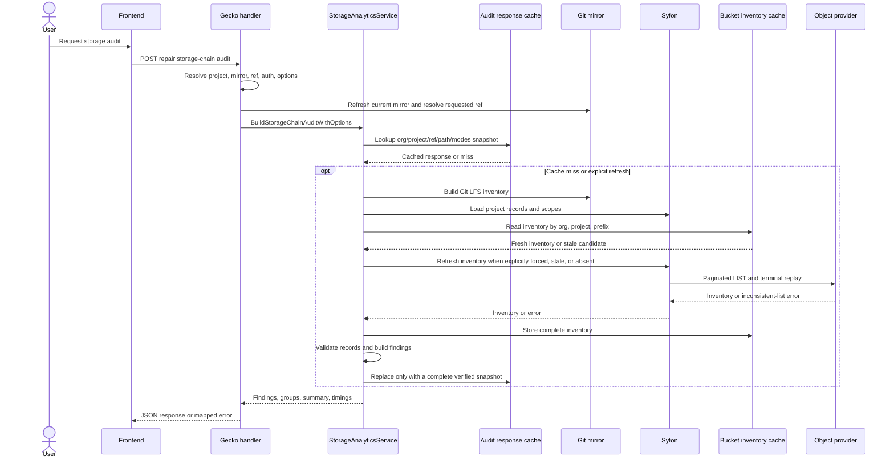

# Gecko storage-chain audit: implementation guide

The storage-chain audit is a read-only cross-check of Git LFS pointers, Syfon project records, project bucket scope mappings, and Syfon bucket inventory. The handler is registered as `POST /git/projects/:orgTitle/:projectTitle/repair/storage-chain/audit` in the [OpenAPI contract](../apgen/openapi/gecko.yaml) and implemented by [`PostGitProjectStorageChainAudit`](../internal/server/httpapi/apiserver/git_analytics_ops.go). Repair endpoints are separate.

## Code map

| Responsibility | Owner |
| --- | --- |
| HTTP request parsing, defaults, and error mapping | [`PostGitProjectStorageChainAudit`](../internal/server/httpapi/apiserver/git_analytics_ops.go) |
| Option normalization and cache selection | [`BuildStorageChainAuditWithOptions`](../internal/storageaudit/chain/audit.go) |
| Saved audit-response cache and refresh coalescing | [`buildStorageChainAuditWithResponseCache`](../internal/storageaudit/chain/audit.go), [`coalesceStorageChainAuditRefresh`](../internal/storageaudit/chain/audit.go) |
| Fresh audit assembly | [`buildStorageChainAuditFresh`](../internal/storageaudit/chain/audit.go) |
| Parallel Git, record, scope, and bucket input loading | [`loadStorageChainInputs`](../internal/storageaudit/chain/inputs.go) |
| Syfon record metrics validator and cache | [`loadProjectAuditRecordsWithRevision`](../internal/storageaudit/chain/inputs_records.go) |
| Durable bucket inventory cache and stale fallback | [`loadCachedProjectBucketValidationInventory`](../internal/storageaudit/chain/inputs_bucket.go) |
| Validation-mode decision tree | [`buildStorageChainView`](../internal/storageaudit/chain/view.go) |
| Finding model | [`buildStorageChainAuditModel`](../internal/storageaudit/chain/findings.go) |
| Git tree inventory index, sidecar persistence, and directory aggregates | [`internal/storageaudit/repoindex`](../internal/storageaudit/repoindex/index.go) |
| Storage summary, folder browsing, child pagination, and project-diff audit | [`internal/storageaudit/browse`](../internal/storageaudit/browse/build.go) |
| Modes, defaults, and timing implementation | [`internal/storageaudit/model`](../internal/storageaudit/model/storage_analytics_timing.go) |
| Public request and response types | [`internal/storageaudit/model`](../internal/storageaudit/model) |
| Shared record state, evidence, URL resolution, and finding classification | [`internal/storageaudit/record`](../internal/storageaudit/record) |
| Repair policy and actionability rules | [`internal/storageaudit/record`](../internal/storageaudit/record/policy.go) |

## Request contract

The handler resolves auth, project context, Git mirror, ref, and commit, then maps the request to `StorageChainAuditOptions` in [`git_storage_analytics.go`](../internal/server/httpapi/git_storage_analytics.go).

| Field | Meaning | Default |
| --- | --- | --- |
| `ref` | Git ref to inspect | Project context ref |
| `git_subpath` | Restricts Git findings to one repository path | Root |
| `bucket_inventory_mode` | `validate` uses the project validation inventory; `items` uses explicit bucket items | `validate` |
| `validation_mode` | `list`, `metadata`, or `inventory` | `list` |
| `probe_mode` | Legacy shorthand: `full` selects metadata and `inventory_only` selects inventory when validation mode is omitted | `full` |
| `finding_kind`, `finding_limit` | Response projection only; cache stores the complete model | All / service default |
| `refresh`, `force_audit_refresh` | Rebuilds the report from the current Git mirror, Syfon records, and scope mappings. Reuses usable bucket inventory and successful per-target observations. | `false` |
| `force_bucket_inventory_refresh` | Rebuilds the report and forces a new complete project bucket LIST. Reuses successful per-target observations. | `false` |
| `force_storage_revalidation` | Rebuilds the report, forces a new complete bucket LIST, and probes every selected target without reusing prior observations. | `false` |

`bucket_path_prefix` is valid only with `bucket_inventory_mode=items` ([handler check](../internal/server/httpapi/apiserver/git_analytics_ops.go)).

## Request-to-response sequence



The handler completes project-read authorization and refreshes the Git mirror before it calls the audit service, including on an initial cache miss. A saved audit hit skips Syfon metrics, record, scope, inventory, and probe calls, while still updating the mirror. The response keeps the Git and Syfon revisions from the saved snapshot until the caller requests a refresh. The response cache has no TTL. Its key uses organization, project, ref, Git subpath, bucket path, and audit modes; Git and Syfon revisions remain metadata and do not change the key.

## Cache hierarchy

| Layer | Scope | Forced-refresh behavior |
| --- | --- | --- |
| Audit response cache | Redis key by org, project, ref, Git subpath, bucket path, and modes | No expiry; explicit refresh rebuilds the snapshot and replaces it only after a complete inventory and usable probe result |
| Project audit lease | Redis key by org and project | 30-second lease, renewed every 10 seconds; the owner token guards response and complete bucket-inventory writes |
| Root response projection | Root snapshot projected to a Git subpath | Uses the Git inventory embedded in the saved root snapshot, never the current tree |
| Exact project join | Redis key by org, project, and Git hash | Five minute TTL; requests read and write Redis directly |
| Project audit records | Syfon project records plus metrics revision | Reloaded for each audit build with the lease context; standalone shared loads use cancellable in-flight work |
| Project scope mappings | Process-local org/project entry | Reused for 45 seconds; forced refresh and successful cleanup mutations reload mappings |
| Successful storage observations | Redis key by org, project, operation, canonical target, expected metadata, applicable scope mapping, and complete inventory fingerprint | No expiry; normal audit refreshes reuse successful `present` observations, including verified mismatches. Errors, unknown results, and missing results are not reused. |
| Requested bucket items | Direct Syfon listing | No process-local copy; each request lists the requested prefix |
| Validation inventory | Redis key by org, project, and validation prefix | Fresh for 10 minutes; last complete Redis value is retained for up to 24 hours |

Responses are cached for root and non-root paths. A subpath can project from a saved root snapshot, and a newer root refresh supersedes an older direct subpath snapshot.

Each Gecko instance keeps one active audit flight for each organization and project ([flight group](../internal/storageaudit/sharedwork/group.go)). Calls share work only when their hashed authorization scope and response key match and the active refresh meets the requested force strength. Other calls for the project wait. A Redis project lease also serializes refreshes across instances ([lease implementation](../internal/storageaudit/storecache/project_audit_gate.go)). After acquiring it, Gecko rechecks the exact response and root projection before building. Different projects use separate leases.

Each caller has a 15-minute budget that includes queue time. Shared work has its own 15-minute budget. A caller that aborts leaves the flight; the worker continues while another caller remains. The last caller cancels the worker. Gecko keeps an abandoned flight registered until its worker exits, so a new request cannot overlap its Redis writes. Server shutdown cancels shared work and waits with the shutdown context.

The project lease expires after 30 seconds and renews every 10 seconds. Its owner token guards report and complete bucket-inventory writes. If renewal fails, Gecko cancels the work context. The owner check prevents that worker from publishing after lease loss. Redis eviction or an upstream provider that ignores cancellation can still allow overlapping upstream work. The response cache has no TTL; the lease TTL does not expire saved reports.

`force_audit_refresh` refreshes the report, records, and scopes after the mirror has been refreshed. It can reuse a complete bucket inventory that is still within the 10-minute freshness window and successful storage observations with matching target inputs. `force_bucket_inventory_refresh` bypasses that inventory cache and requires a complete LIST. `force_storage_revalidation` also bypasses the per-target observation cache and verifies every selected target again. Both stronger requests fail if their fresh inventory is incomplete or storage verification remains unresolved. A failed refresh leaves the previous response snapshot in place. Confirmed missing and metadata mismatch findings remain normal evidence, not refresh errors.

The per-target observation cache stores each successful, validated batch as the Syfon response arrives. Gecko uses a separate five-second Redis context for each checkpoint, so an HTTP abort that races a completed batch does not discard its progress. If a later HTTP batch fails, Gecko keeps earlier positive observations and retries only unresolved targets on the next audit. An ordinary refresh reuses those observations when the expected metadata, canonical URL, scope mapping, and applicable complete-inventory fingerprint still match. A full storage revalidation bypasses them. If a live result reports a target as missing, Gecko records a retirement marker so an older positive observation cannot be reused for that target under another operation or expected metadata value. The response exposes each reused probe's `cache_hit` value and original `observed_at` timestamp.

No expiry means Gecko does not schedule a TTL for the response key. Redis eviction, Redis persistence or flush behavior, and process restarts can still remove entries. The production HTTP server requires Redis at startup for the saved response, exact project join, validation inventory, and successful storage observation caches. A missing URL, malformed URL, disabled cache setting, or failed Redis ping prevents server initialization. Redis GET and SET errors fail the affected request; Gecko does not rebuild an audit response, exact join, validation inventory, or storage observation from a local copy after a cache operation fails. Direct in-process `StorageAnalyticsService` instances are unconfigured until their caller explicitly injects caches or initializes them from the environment; the HTTP server always performs that initialization before serving.

The 45-second project scope mapping cache remains process-local to avoid repeating the same Syfon scope lookup within one Gecko instance. Project audit records, bucket inventory rows, and storage observations do not use a process-local result cache. The observation cache applies only to chain-audit evidence attachment. Cleanup and registration probes continue to call Syfon for live results. The Git repository index has its own Git-derived cache, separate from these Syfon audit caches.

### Validation inventory cache sequence

```mermaid
sequenceDiagram
    participant Audit as Gecko audit
    participant Cache as Validation inventory cache
    participant Syfon
    participant S3 as Object provider

    Audit->>Cache: Get org project validation-prefix key
    Cache-->>Audit: Fresh value under 10 minutes
    Note over Audit: Fresh value: do not call Syfon.
    Audit->>Syfon: If stale or absent, list project bucket inventory
    Syfon->>S3: Traverse pages and replay terminal page
    S3-->>Syfon: Complete consistent inventory
    Syfon-->>Audit: Complete inventory
    Audit->>Cache: Replace value and set 24-hour retention
    Note over Syfon,Audit: Terminal replay mismatch returns an error.
    Cache-->>Audit: Normal request may use the last complete value
    Note over Audit: Forced refresh fails on LIST error; it does not use stale inventory.
```

Only complete inventories replace the inventory cache. Syfon terminal-page disagreement is an error, never a partial successful response. A normal request may use the previous complete inventory when a refresh fails. A cold audit with a failed LIST returns an explicitly unavailable inventory report and does not issue a HEAD request for every record. Inventory-derived absence remains unconfirmed.

## Fresh audit execution

1. `loadStorageChainInputs` starts Git inventory, Syfon records, Syfon scopes, and bucket data concurrently ([input loading](../internal/storageaudit/chain/audit.go)).
2. Git, record, and scope errors fail the request. Bucket errors are carried as `bucketInventoryErr`, so validation mode decides whether they are fatal. An explicit bucket refresh also fails if LIST fails or returns an incomplete inventory ([input loading](../internal/storageaudit/chain/inputs.go)).
3. `buildStorageChainView` canonicalizes Syfon record URLs through bucket scopes and attaches list or bulk-probe evidence.
4. `buildStorageChainAuditModel` indexes canonical bucket URLs, Git checksums, and Syfon records, then runs bucket-origin, Syfon-origin, and Git-origin finding passes.
5. Gecko filters and limits only after constructing the complete model. `Groups` use all filtered rows, while `Findings` can be truncated ([response shaping](../internal/storageaudit/chain/audit.go)).

### Validation modes

| Mode | Bucket LIST | Additional Syfon work | Bucket view |
| --- | --- | --- | --- |
| `validate` + `list` | Yes, through durable inventory cache | Targeted HEAD checks for complete-list misses | Incomplete-list misses remain unverified |
| `validate` + `metadata` | Skipped unless `force_bucket_inventory_refresh` or `force_storage_revalidation` is set | Bulk metadata validation | Synthesized from present probes |
| `validate` + `inventory` | Skipped | None | No bucket list |
| `items` + `list` or `inventory` | Yes, using requested prefix | None | Explicit bucket items |
| `items` + `metadata` | Yes | Probe only records needing confirmation | Listed items plus probe evidence |

The branch is at [`buildStorageChainView`](../internal/storageaudit/chain/view.go). Gecko enables bucket-origin findings only when it has trustworthy list inventory ([decision](../internal/storageaudit/chain/audit.go)).

## Findings and error semantics

The summary keys are initialized in [`newChainSummary`](../internal/storageaudit/chain/audit.go).

| Finding kind | Meaning |
| --- | --- |
| `bucket_only_object` | Bucket object has no matching Syfon record or equivalent record identity |
| `bucket_syfon_no_git` | Syfon record resolves to storage but no Git pointer joins it |
| `syfon_missing_bucket_object` | Record storage cannot be resolved from trustworthy list/probe evidence |
| `syfon_git_no_bucket` | Git and Syfon join but storage evidence is missing |
| `git_only_no_syfon` | Git LFS pointer has no Syfon record |
| `git_syfon_metadata_mismatch` | Joined Git, Syfon, and storage metadata conflict |
| `probe_error` | Verification is inconclusive; it is not a missing-object assertion |

For Weka failures, a Syfon traversal error without cached inventory fails the audit. A stale-cache fallback succeeds from older known-good inventory; it must not generate `probe_error` rows from a false empty list.

## Observability and tests

| Log | Meaning |
| --- | --- |
| `syfon_project_bucket_inventory_cache_hit` | Fresh inventory reused |
| `syfon_project_bucket_inventory_cache_store` | Successful non-empty inventory replaced cache |
| `syfon_project_bucket_inventory_cache_stale_fallback` | Syfon refresh failed; stale good inventory used |
| `syfon_project_bucket_inventory_cache_error` | Redis operation failed; Gecko fails the affected request |
| `storage_chain_audit_request_error` | Handler is returning a mapped audit error |

Stage timings use `storage_chain_audit_stage_start` and `storage_chain_audit_stage_done`; memory snapshots include Git file, Syfon record, and bucket object counts ([timing implementation](../internal/storageaudit/model/storage_analytics_timing.go)).

Run focused coverage from the Gecko repository:

```bash
GOCACHE=/private/tmp/gecko-gocache go test ./internal/storageaudit -run 'TestBuildStorageChainAuditForceRefreshBypassesResponseCache|TestProjectBucketInventoryUsesStaleCacheWhenRefreshFails|TestProjectBucketInventoryCacheRetention' -count=1
```

The relevant tests are [`internal/storageaudit/chain_test.go`](../internal/storageaudit/chain_test.go) and [`internal/storageaudit/storecache/cache_test.go`](../internal/storageaudit/storecache/cache_test.go).
